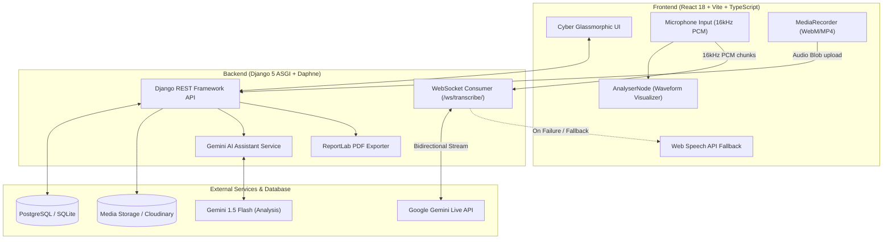

# VoiceText AI · Real-Time Multilingual Transcription

> **Procucev AI Tech Hiring Assignment 1: Real-time Transcription**  
> A production-grade speech-to-text web application powered by **Google Gemini Live API** (multimodal WebSocket proxy) with seamless auto-fallback to the **Browser Web Speech API**, supporting code-mixed speech (Tamil + English, Hindi + English, Telugu, Kannada, Malayalam).

[](LICENSE)
[](https://www.python.org/)
[](https://www.djangoproject.com/)
[](https://react.dev/)
[](https://www.typescriptlang.org/)
[](https://tailwindcss.com/)

---

## 📸 Overview & UI Preview

VoiceText is crafted with a **futuristic cyber dark glassmorphism design** featuring a deep navy gradient (`#04121A` → `#062A33`), neon cyan glowing accents (`#22D3EE`), symmetrical live audio waveform visualization (`Web Audio API AnalyserNode`), and corner bracket accents.

### Core Highlights
- 🎙️ **Live Streaming Speech-to-Text**: High-frequency 16 kHz PCM audio chunks stream over WebSockets to Django Channels, proxied to **Gemini Live API**.
- 🌐 **Multilingual & Code-Mixed**: Real-time transcriptions preserved in native scripts (Tamil in தமிழ், Hindi in हिन्दी, English in Latin script).
- 🛡️ **Zero API Key Leakage**: The Gemini API key is securely isolated on the backend.
- 🔄 **Intelligent Engine Fallback**: Automatic failover to browser **Web Speech API** if connection drops or API quota is reached.
- 🎧 **Parallel Audio Recording**: Simultaneous `MediaRecorder` audio capture for playback with scrubbing, speed control (0.75x–2x), and download.
- 🤖 **Agent-Like AI Assistant**: Post-recording synthesis generates titles, 2-line summaries, key takeaways, action items, and translations (English, Tamil, Hindi).
- 🔗 **Public Read-Only Share Link**: Public access at `/s/<token>` for transcript + audio player.
- 🔊 **Text-to-Speech (Read Aloud)**: Native `speechSynthesis` playback matched to transcript dialect.
- 📦 **Multi-Format Export**: One-click download as `.TXT`, `.PDF` (ReportLab formatted), `.JSON`, or `.SRT` subtitle file.
- 🔒 **Anonymous Device Isolation**: Per-device UUID isolation guarantees users never see each other's data without mandatory passwords.

---

## 🏛️ System Architecture



---

## ⚡ Tech Stack

| Layer | Technology | Rationale |
|---|---|---|
| **Backend Framework** | Python 3.12, Django 5.1, DRF | Robust ORM, enterprise security, and clean REST endpoints |
| **ASGI & WebSockets** | Django Channels 4.3, Daphne | High-performance asynchronous WebSocket proxying |
| **Primary Speech Engine**| Google Gemini Live API | Industry-leading live multilingual & code-mixed transcription |
| **Fallback Speech Engine**| Web Speech API (`SpeechRecognition`) | Zero-latency browser fallback ensuring 100% demo uptime |
| **Frontend Framework** | React 18, Vite 5, TypeScript | Rapid compilation, strict type safety, modular design |
| **Styling & Animation** | Tailwind CSS, Framer Motion | Futuristic glassmorphism, neon glows, responsive layouts |
| **Audio Processing** | Web Audio API (`AnalyserNode`), `MediaRecorder` | Real-time waveform rendering & audio file capture |
| **Database** | PostgreSQL (Render) / SQLite (Local Dev) | Seamless environment switch via `DATABASE_URL` |
| **PDF Generation** | ReportLab 5.0 | Formatted PDF transcript exports with styled metadata tables |

---

## 🚀 Quickstart Guide (Local Development)

### 1. Prerequisites
- Python 3.12+
- Node.js 18+ & npm 9+
- Git

### 2. Clone Repository
```bash
git clone https://github.com/your-username/VoiceText.git
cd VoiceText
```

### 3. Backend Setup
```bash
# Create virtual environment
python -m venv .venv

# Activate virtual environment
# Windows PowerShell:
.\.venv\Scripts\Activate.ps1
# macOS/Linux:
source .venv/bin/activate

# Install dependencies
pip install -r backend/requirements.txt

# Run migrations
python backend/manage.py migrate

# (Optional) Set your Gemini API key in backend/.env or environment:
# GEMINI_API_KEY=your_key_here

# Start ASGI Daphne server
daphne -b 127.0.0.1 -p 8000 --root-path backend voicetext.asgi:application
```
*Backend runs on `http://127.0.0.1:8000` with WebSocket support at `ws://127.0.0.1:8000/ws/transcribe/`.*

### 4. Frontend Setup
In a new terminal window:
```bash
cd frontend

# Install packages
npm install

# Start Vite development server
npm run dev
```
*Frontend runs on `http://localhost:5173`.*

---

## 🐳 Docker & Docker Compose

Run the entire stack with PostgreSQL, Daphne ASGI backend, and Nginx frontend in a single command:

```bash
# Create .env from template
cp .env.example .env

# Build and start all services
docker-compose up --build
```
- Frontend: `http://localhost:3000`
- Backend API: `http://localhost:8000/api/`
- PostgreSQL: `localhost:5432`

---

## 📡 REST API Reference

All requests accept and attach the `X-Session-ID` header for anonymous device isolation.

| Method | Endpoint | Description |
|---|---|---|
| `GET` | `/api/transcriptions/` | List transcriptions with search, filter, and pagination |
| `POST` | `/api/transcriptions/` | Create a new transcription record |
| `GET` | `/api/transcriptions/<id>/` | Retrieve a transcription by UUID |
| `PATCH` | `/api/transcriptions/<id>/` | Update title or transcript text |
| `DELETE`| `/api/transcriptions/<id>/` | Delete a transcription |
| `POST` | `/api/transcriptions/bulk_delete/` | Bulk delete records by array of IDs `{"ids": [...]}` |
| `POST` | `/api/transcriptions/<id>/toggle_favorite/` | Toggle favorite star status |
| `POST` | `/api/transcriptions/<id>/audio/` | Multipart audio file upload (`audio_file`) |
| `POST` | `/api/transcriptions/<id>/share/` | Toggle public link status (`/s/<token>`) |
| `GET` | `/api/transcriptions/<id>/export/?format=txt\|pdf\|json\|srt` | Export transcription in requested format |
| `POST` | `/api/transcriptions/<id>/analyze/` | Trigger Gemini AI Assistant analysis |
| `GET` | `/api/public/share/<token>/` | Public read-only session data |
| `GET` | `/api/stats/` | Session metrics (sessions, minutes, words, top language) |
| `GET/POST`| `/api/settings/` | Get or update device preferences |

---

## 🧪 Testing Suite

### Run Backend Unit Tests (8/8 Passing)
```bash
# In backend directory:
python manage.py test transcriptions
```
Covers:
- `test_list_transcriptions_session_isolation`: Device isolation verification
- `test_create_transcription`: Word count and database persistence
- `test_search_and_filter`: Query search, language filter, favorite filter
- `test_toggle_favorite`: State toggling
- `test_bulk_delete`: Multi-item deletion
- `test_export_txt_json_srt`: Content validation for TXT, JSON, and SRT
- `test_public_share`: Public share token access
- `test_stats_endpoint`: Aggregation of minutes and word count

### Run Frontend Smoke Test
```bash
# In frontend directory:
npm test
```
Verifies Vite build output, production HTML bundle, CSS injection, and root mounting.

---

## 🌐 Production Deployment Guide

### A. Deploy Backend + PostgreSQL on Render

1. **Create Managed PostgreSQL Database**:
   - Go to [dashboard.render.com](https://dashboard.render.com/) → **New +** → **PostgreSQL**.
   - Name: `voicetext-db`.
   - Copy the **Internal Database URL**.

2. **Create Web Service for ASGI Backend**:
   - Click **New +** → **Web Service** → Connect your GitHub repository.
   - **Root Directory**: `backend`
   - **Runtime**: `Python 3`
   - **Build Command**: `bash build.sh`
   - **Start Command**: `daphne -b 0.0.0.0 -p $PORT voicetext.asgi:application`
   - **Environment Variables**:
     - `PYTHON_VERSION`: `3.12.3`
     - `DEBUG`: `False`
     - `SECRET_KEY`: *(Generate a secure random string)*
     - `ALLOWED_HOSTS`: `*`
     - `DATABASE_URL`: *(Paste your Render database connection string)*
     - `GEMINI_API_KEY`: *(Your key from Google AI Studio)*
     - `GEMINI_LIVE_MODEL`: `gemini-2.0-flash-exp`
     - `GEMINI_TEXT_MODEL`: `gemini-1.5-flash`

### B. Deploy Frontend on Netlify

1. Go to [app.netlify.com](https://app.netlify.com/) → **Add new site** → **Import an existing project**.
2. Connect your repository.
3. Configure build settings:
   - **Base directory**: `frontend`
   - **Build command**: `npm run build`
   - **Publish directory**: `frontend/dist`
4. Set Environment Variables:
   - `VITE_API_URL`: `https://your-render-app.onrender.com`
   - `VITE_WS_URL`: `wss://your-render-app.onrender.com/ws/transcribe/`
5. Deploy! Netlify automatically honors `netlify.toml` for Single Page Application URL routing.

---

## ⌨️ Keyboard Shortcuts

| Shortcut | Action |
|---|---|
| <kbd>Space</kbd> | Start / Stop Live Recording |
| <kbd>C</kbd> | Copy active transcript to clipboard |
| <kbd>S</kbd> | Open Share dialog |
| <kbd>/</kbd> | Instant focus to search bar |

---

## 📄 License
This project is licensed under the [MIT License](LICENSE).
